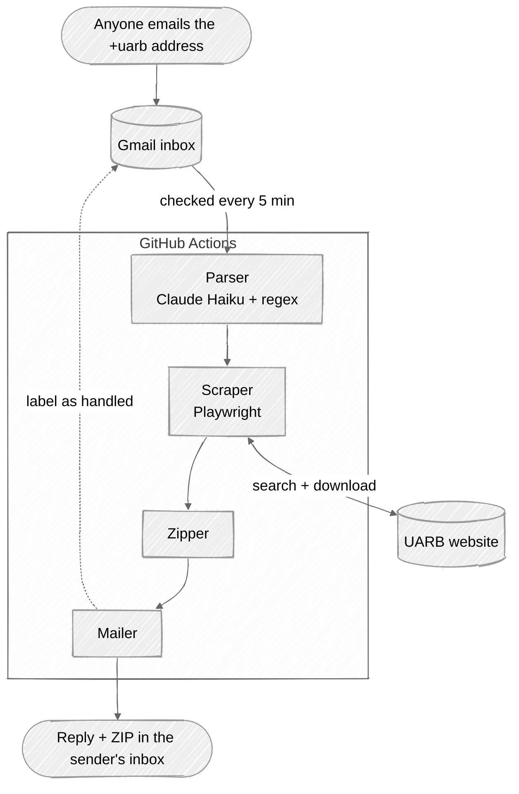

# UARB Regulatory Document Agent

An email agent for the Nova Scotia Utility and Review Board's public documents database. Email it a matter number and a document type. It downloads up to 10 of those documents, zips them, and replies with the ZIP plus a summary of the matter.

---

# Talk to the Agent

The agent is live. Email **frank.chen.ziy+uarb@gmail.com** from any address, for example:
> Hi Agent, can you give me Other Documents files from M12383? Thanks!

**How long it takes:** usually **5–15 minutes**.
- The agent runs on GitHub Actions and checks for new emails every 5 minutes.
- GitHub sometimes starts scheduled runs late, so a reply can occasionally take longer.
- Once your email is picked up, the request itself takes under a minute.

### How it's deployed
[`.github/workflows/agent.yml`](.github/workflows/agent.yml) runs the agent on GitHub's servers, so it answers emails without a laptop staying on.
- **Every 5 minutes** it starts a fresh machine, installs everything, runs `run --once` to answer new emails, and exits.
- **No server or database is needed.** The Gmail `UARB-handled` label remembers which emails have been answered, so every run picks up where the last one left off.
- **Only one run happens at a time**, so the same email is never answered twice.
- **Only emails sent to the `+uarb` address are read.** Everything else in the inbox is never opened.

**Things to know:**
- **For faster replies, run it locally** (see [Running It](#running-it)): it checks every 30 seconds and replies in about a minute. Turn off the GitHub workflow first (**Actions → UARB agent → ⋯ → Disable workflow**), or both copies may answer the same email.

---

# Initial System Design

I broke the problem into independent components so the agent could build and test each step quickly.

```
Inbox poller → Parser → Scraper → Zipper → Reply sender
            (all wired together by one orchestrator)
```


### Components
1. **Inbox Poller**
   - Check the Gmail inbox for unread emails every 30s
   - Process one request at a time

2. **Email Parser**
   - Extract `matter_number` (e.g. M12205)
   - Extract `document_type` (Exhibits, Key Documents, Other Documents, Transcripts, Recordings)
   - Use an LLM for this, since people phrase requests differently
   - Double-check the matter number with a regex so the LLM can't make one up

3. **Website Navigation**
   - Navigate to:
   https://uarb.novascotia.ca/fmi/webd/UARB15
   - Enter matter number
   - Open relevant document tab

4. **Document Scraper**
   - Count available documents in every tab
   - Download up to 10 using the **GO GET IT** links

5. **Metadata Extractor**
   Extract:
   - Matter title
   - Category
   - Type
   - Date received
   - Date final submissions

6. **ZIP Compressor**
   - Bundle downloaded files

7. **Email Response**
   - Attach ZIP
   - Include metadata summary
   - Include document counts
   - Reply with a helpful error if something goes wrong (bad matter number, no documents, etc.)

---


# How It Works



1. **Inbox:** every 5 minutes (every 30s when run locally), the agent checks for emails sent to `+uarb` that don't have the `UARB-handled` label yet. Automatic mail (auto-replies, mailing lists, no-reply senders) is skipped.
2. **Parser:** Claude reads the email and a regex checks the result, giving `{ matter: M12205, type: Key Documents }`.
3. **Scraper:** Playwright searches the matter on the UARB site, reads its details and tab counts, and downloads up to 10 files.
4. **Zipper:** packs them into one ZIP that fits in an email.
5. **Mailer:** replies in the same thread with the ZIP and the summary, then labels the request `UARB-handled`.

### Key Decisions
- **Playwright for the browser.** The site is a FileMaker WebDirect app, so there's no plain HTML to scrape. Everything renders with JavaScript.
- **LLM only for parsing the email.** Metadata comes straight from the page, so numbers and dates can't be hallucinated.
- **Gmail IMAP/SMTP with an App Password.** Simplest setup with no OAuth.
- **Pydantic** to validate the parsed request and the scraped data.

### Tech Stack
- **Python 3.12**
- **Playwright** (Chromium) for browser automation
- **Claude Haiku 5.5** (Anthropic API) to parse emails into a structured request
- **Pydantic** for validation, and **pydantic-settings** to load secrets from `.env`
- **imap-tools** to read the Gmail inbox
- **smtplib** (built-in) to send replies
- **zipfile** (built-in) to build the ZIP
- **tenacity** to retry flaky page loads

---

# Setup

**1. Install** (Python 3.12):
```bash
uv venv --python 3.12 .venv
uv pip install --python .venv -r requirements.txt   # or: source .venv/bin/activate && pip install -r requirements.txt
.venv/bin/playwright install chromium
```

**2. Get a Gmail App Password.**
1. Turn on 2-Step Verification for the Gmail account the agent will use.
2. Create an App Password at [myaccount.google.com/apppasswords](https://myaccount.google.com/apppasswords). Google shows a 16-character password once; copy it.

**3. Get an Anthropic API key** from [console.anthropic.com](https://console.anthropic.com).

**4. Create `.env`:**
```bash
cp .env.example .env
```

| Variable | What it is |
|---|---|
| `GMAIL_ADDRESS` | The Gmail account the agent uses, e.g. `yourname@gmail.com` |
| `GMAIL_APP_PASSWORD` | The 16-character App Password from step 2 |
| `ANTHROPIC_API_KEY` | Your Anthropic key from step 3 |
| `HEADLESS` | `true` to hide the browser, `false` to watch it work |

The agent's address is your Gmail address with `+uarb` added: `yourname+uarb@gmail.com`. Gmail delivers it to your normal inbox, and the agent ignores everything that wasn't sent to that address.

---

# Running It

```bash
.venv/bin/python -m src.main run            # watch the inbox and answer requests (Ctrl+C to stop)
.venv/bin/python -m src.main run --once     # answer what's waiting, then exit
```

Try each part on its own:
```bash
.venv/bin/python -m src.main inbox                                     # list waiting requests (changes nothing)
.venv/bin/python -m src.main parse "send me the exhibits for m12205"   # see what the parser understood
.venv/bin/python -m src.main fetch M12205 "Other Documents"            # scrape + zip + preview the reply, no email sent
```

### Demo
1. Start the agent: `.venv/bin/python -m src.main run`
2. From any other email account, send this to `yourname+uarb@gmail.com`:
   > Hi Agent, can you give me Other Documents files from M12205? Thanks!
3. Watch the terminal: email found → request parsed → 10 files downloaded → reply sent.
4. The reply arrives in the sender's inbox in the same thread, with a ZIP of 10 PDFs.

---
